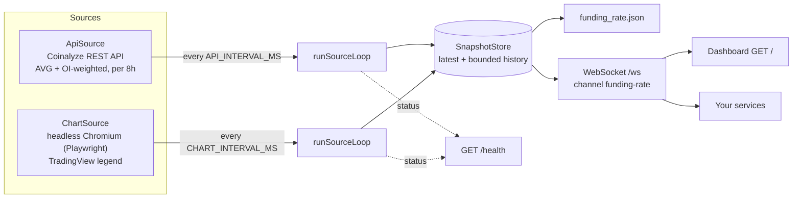

# Coinalyze Aggregated Predicted Funding Rate

[](https://github.com/tarikcaykara/coinalyze-api/actions/workflows/ci.yml)
[](https://bun.sh)
[](https://www.typescriptlang.org)
[](https://www.docker.com)
[](LICENSE)

A Bun + TypeScript service that computes the cross-exchange **aggregated predicted funding rate** (BTC, ETH, SOL) from the official Coinalyze REST API and streams it over an authenticated WebSocket. A second, optional source reads the same metric from Coinalyze's TradingView chart so the dashboard can show both values and how far they diverge.


<!-- Replace with docs/demo.gif once recorded -->

## Why

- The Coinalyze API exposes predicted funding rates **per market** (`/predicted-funding-rate`) but has **no aggregated endpoint**. The "Aggregated Predicted Funding Rate" exists only as a chart on coinalyze.net.
- The chart is not a real-time feed. Coinalyze's own funding page says *"This chart is not updated in real-time yet"*, and in practice its value holds for minutes at a time.
- v2 therefore aggregates the per-market API data itself, using two methods: a simple average and an open-interest-weighted average. Both are normalized to 8h. The chart scraper from v1 stays on as a reference that measures how close the aggregation gets.

## Architecture



- **One loop per source.** Each loop is drift-free: intervals are measured start-to-start. The first poll runs immediately. A failed cycle is logged, counted in `/health`, and retried on the next cycle. The loop never exits the process.
- **`ApiSource`.**
  - The market list is cached for 24h and open interest for 10 min. Predicted funding rates are fetched every cycle.
  - Requests go through a token-bucket limiter (40 calls/min; each symbol costs one call; at most 20 symbols per request) and honour `Retry-After` on 429.
- **`ChartSource`.**
  - One page per coin, all loaded concurrently. Each cycle reloads the page and re-selects the 1-minute interval.
  - The page is fully re-navigated every `SESSION_REFRESH_MS`.
  - Recovery goes in three tiers: reload, then a full load for that coin, then a browser restart if every coin failed. A single tracked Chromium instance means nothing can leak.
- **`SnapshotStore`.** Holds the latest snapshot per (source, coin) plus up to 720 points of history each. The latest snapshots are persisted to `funding_rate.json`, and each new snapshot is published to the `funding-rate` channel.

## How aggregation works

For each coin, the API source takes every perpetual market in scope. For each market `i` it reads the predicted rate `rᵢ` (normalized to % per 8h) and the open interest `OIᵢ` in USD, then computes:

$$\text{AVG} = \frac{1}{n}\sum_{i=1}^{n} r_i \qquad\qquad \text{OI-weighted} = \frac{\sum_i r_i \cdot OI_i}{\sum_i OI_i}$$

- **Which markets count:**
  - AVG uses every market with a finite predicted rate.
  - OI-weighted uses only markets that also have a finite OI greater than 0.
  - Markets the API reports without a predicted rate (`n/a`, e.g. Deribit, Huobi, OKX) are skipped.
- **8h normalization:** exchanges that settle hourly are multiplied by 8, just as Coinalyze normalizes rates to 8 hours on its site. The multipliers live in [`src/sources/api/aggregate.ts`](src/sources/api/aggregate.ts) (`FUNDING_NORMALIZATION`).
- **Market scope:** `MARKET_SCOPE = "stable"` means only stablecoin-margined perpetuals count (`margined === "STABLE"`). The calibration below chose this.

These two methods mirror the ones Coinalyze describes for its own aggregation: a simple average by default and an optional OI-weighted average.

## Calibration results

Measured on 2026-10-13: 10 synchronized samples of ETH, taken 60 s apart. Each sample includes the chart legend (1-minute interval), the per-exchange "Current / Predicted" table on the same page, and the API's predicted rates.

| Check | Result | Decision |
|---|---|---|
| Unit: page % ÷ API value, Binance ETHUSDT | median 0.999 (0.996–1.006) | API values are already in % (`API_VALUE_TO_PERCENT = 1`) |
| Binance USDC & coin-margined, Bybit ×3, WOO X | 0.991–1.010 | already per 8h |
| Hyperliquid | 8.000 in 10/10 samples | hourly → ×8 |
| Kraken | median 8.02 (synchronized samples: 0.0098 vs 0.00977) | hourly → ×8 |
| Mean \|AVG − chart\|, all perpetuals (21 with a value) | 0.00122 pp (17.2 % of the mean chart value 0.00713 %) | — |
| Mean \|AVG − chart\|, stablecoin-margined (18) | **0.00079 pp (11.1 %)** | `MARKET_SCOPE = "stable"` |
| Same, without the hourly ×8 fix | all 0.00197 pp, stable 0.00166 pp | normalization matters |

Notes:
- **The residual gap is mostly chart lag.** The chart held one value for 3–4 minutes while per-market rates moved underneath it.
- **The "10" in "AVG close 10" is still unexplained.** Averaging only the 10 stablecoin markets listed on the page (7 of which have a predicted value) tracks the chart no better (0.00076 pp) than the 18 API stable markets do. So the "10" is not confirmed to be the market count. The legend value also changes with the chart interval: in a separate one-off check before calibration, the 1-hour interval read 0.0068 and the 1-minute interval read 0.0049. That timeframe dependence hints at a bar-based setting rather than a market count.
- **Unmeasured exchanges:** Lighter, Polymarket, dYdX, Aster, Bitfinex, Gate.io, Phemex and Coinbase don't appear on the page, so their 8h factors couldn't be checked. The API also still returned a value for Coinbase ETH-PERP whose `update` timestamp was 12 days old.

Re-run the calibration if Coinalyze changes its units or market listings.

## Quick start

1. **Get a free API key.** Sign in or sign up at [coinalyze.net](https://coinalyze.net), open [coinalyze.net/account/api-key](https://coinalyze.net/account/api-key/) and click **Generate**. Generating a new key deactivates the old one immediately, and the new key only starts working **2 minutes** later.
2. **Configure and run:**

```bash
git clone https://github.com/tarikcaykara/coinalyze-api.git
cd coinalyze-api
cp .env.example .env              # set AUTH_TOKEN and COINALYZE_API_KEY
bun install
bunx playwright install chromium  # only needed for the chart source
bun run start                     # dashboard on http://localhost:3000, WebSocket on /ws
```

Run a single snapshot set to stdout and exit (exit code 1 if no source produced a value):

```bash
bun run once
SOURCES=api COINS=ETH bun run once
```

Bun loads `.env` automatically, so no `dotenv` package is needed. `SOURCES=api` never loads Playwright.

## Docker / Compose

```bash
cp .env.example .env   # set AUTH_TOKEN and COINALYZE_API_KEY
docker compose up --build -d
docker compose ps      # "healthy" after the first check; /health stays 200 while any source is fresh
```

- **Image:** pinned to `oven/bun:1.4.3-debian`, with Chromium installed by `bunx playwright install --with-deps chromium`.
- **Runtime:** the container runs as the non-root `bun` user with a `HEALTHCHECK` against `/health`.
- **Compose settings:**
  - `shm_size: 1gb`: Chromium needs a larger `/dev/shm`.
  - `init: true`: reaps orphaned Chromium processes.
  - `stop_grace_period: 15s`: SIGTERM triggers a graceful shutdown that closes the browser.

## Configuration

| Variable | Default | Description |
|---|---|---|
| `PORT` | `3000` | HTTP + WebSocket port |
| `AUTH_TOKEN` | *(required in loop mode)* | Token WebSocket clients must send; there is no default |
| `COINALYZE_API_KEY` | *(required when `SOURCES` includes `api`)* | Coinalyze API key |
| `SOURCES` | `api,chart` | Comma-separated: `api`, `chart` |
| `COINS` | `BTC,ETH,SOL` | Comma-separated subset of `BTC`, `ETH`, `SOL` |
| `API_INTERVAL_MS` | `120000` | API cycle interval. Keeps 3 coins within the 40 calls/min budget (about 34/min) |
| `CHART_INTERVAL_MS` | `60000` | Chart cycle interval |
| `SESSION_REFRESH_MS` | `3600000` | Full chart re-navigation interval; long-lived TradingView sessions drift |
| `PING_INTERVAL_MS` | `30000` | WebSocket ping interval |
| `PONG_TIMEOUT_MS` | `65000` | Close a client with no pong within this window |
| `AUTH_TIMEOUT_MS` | `10000` | Close a client that has not authenticated within this window |

- Integers must be positive whole numbers. Invalid values stop the process at startup with a clear message.
- The v1 variable `INTERVAL_MS` was replaced by `API_INTERVAL_MS` and `CHART_INTERVAL_MS`. Setting it is an error.
- With 3 coins, the first API cycle takes about 2–3 minutes: it has to fetch open interest *and* predicted rates for about 57 markets at 40 calls/min. Later cycles reuse the cached open interest.

## WebSocket protocol

Endpoint: `ws://<host>:<PORT>/ws`. All messages are JSON.

| Direction | Message |
|---|---|
| client → server | `{"type":"auth","token":"<AUTH_TOKEN>"}` (must arrive within `AUTH_TIMEOUT_MS`) |
| server → client | `{"type":"auth","status":"ok","coins":["BTC","ETH","SOL"],"sources":["api","chart"],"interval_ms":{"api":120000,"chart":60000}}` |
| server → client | `{"type":"history","snapshots":[Snapshot, …]}` sent right after auth (ascending by time) |
| server → client | `Snapshot` on every successful cycle, one per (source, coin) |
| server → client | `{"type":"ping"}` every `PING_INTERVAL_MS`; reply with `{"type":"pong"}` |
| server → client | `{"type":"error","message":"invalid json" \| "unknown message type"}` |

`Snapshot` (this is also the element type of the `funding_rate.json` array):

```json
{
  "type": "snapshot",
  "source": "api",
  "symbol": "ETH",
  "coin": "ethereum",
  "timestamp": 1791927283328,
  "aggregated_predicted_funding_rate": 0.006492705899470914,
  "oi_weighted_predicted_funding_rate": 0.006957535040949811,
  "markets": 18,
  "unit": "percent_per_8h"
}
```

Chart snapshots have `oi_weighted_predicted_funding_rate: null` and `markets: null`.

| Close code | Meaning |
|---|---|
| `4001` | invalid token (the server sends `{"type":"auth","status":"error","message":"invalid token"}` first) |
| `4002` | pong timeout |
| `4003` | no auth message within `AUTH_TIMEOUT_MS` |

**Migrating from v1:**
- `aggregated_predicted_funding_rate`, `coin` and `timestamp` keep their names and meaning.
- Several coins and sources now share the `funding-rate` channel, so filter on `source` and `symbol`.
- The first data message after auth is now `{"type":"history"}` rather than a bare payload.
- `funding_rate.json` is now an array of the latest snapshots.

## `GET /health`

Returns `200` when the status is `ok` or `degraded` and `503` when it is `down`:

```json
{
  "status": "ok",
  "uptime_s": 222,
  "sources": {
    "api": { "healthy": true, "interval_ms": 120000, "last_success_at": 1791927463537, "consecutive_failures": 0, "last_error": null },
    "chart": { "healthy": true, "interval_ms": 60000, "last_success_at": 1791927496188, "consecutive_failures": 0, "last_error": null }
  }
}
```

- A source is **healthy** if it succeeded within the last 3 intervals. Before its first success, it also counts as healthy until 3 intervals have passed since startup.
- The overall status is `ok` if all sources are healthy, `degraded` if some are and `down` if none are.

## Development

```bash
bun test            # unit + protocol tests; no network, no browser
bun run typecheck   # tsc --noEmit (strict)
```

```
src/
  main.ts                       entry: config → store → sources → loops → server; --once; signals
  config.ts                     env/argv parsing + validation
  coins.ts                      coin registry (symbol → Coinalyze slug)
  types.ts                      Snapshot, Source, SourceStatus
  log.ts                        stderr logger (stdout is reserved for --once JSON)
  store.ts                      SnapshotStore (latest + history + funding_rate.json)
  loop.ts                       runSourceLoop (drift-free, never exits)
  health.ts                     computeHealth (pure)
  server.ts                     Bun.serve: dashboard, /health, /ws protocol
  sources/api/rate-limiter.ts   token bucket (40/min)
  sources/api/client.ts         CoinalyzeClient (chunking, 429 Retry-After, 401)
  sources/api/aggregate.ts      AVG / OI-weighted + calibration constants
  sources/api/source.ts         ApiSource
  sources/chart/parse.ts        legend regex, Cloudflare page classification
  sources/chart/browser.ts      BrowserManager (single tracked Chromium)
  sources/chart/page.ts         ChartPage (full load / reload / 1-minute selection / read)
  sources/chart/source.ts       ChartSource (concurrent coins, tiered recovery)
web/                            dashboard (Bun HTML import + lightweight-charts)
test/                           bun:test suites
```

## Design notes: v1 → v2

v1 was a single 390-line `scraper.js`. It worked on a good day; the rewrite addresses what it did on bad days:

- **Zombie process.**
  - v1: the first page load ran outside the retry loop. A startup failure left the WebSocket server up with scraping dead, and nothing reported it.
  - v2: every source runs in the same retrying loop from its first poll, and `/health` reports staleness.
- **Leaked browsers.**
  - v1: the browser restart path launched a new Chromium without storing it, leaking a process on every restart.
  - v2: `BrowserManager` owns exactly one instance. A test asserts that each instance is closed exactly once.
- **Silent timeframe reset.**
  - v1: `page.reload()` put the chart back on its default interval without re-selecting 1 minute. The fallback selector `:has-text("1m")` could also match "1M" (month) or "15m".
  - v2: re-selects after every reload, using the dropdown item `data-value="1"`, and verifies the result.
- **Small parsing and protocol bugs.**
  - A bare `-` used to parse as `NaN`.
  - Cloudflare's "Just a moment…" interstitial wasn't detected.
  - Unauthenticated sockets were closed with the misleading "pong timeout" code.
  - A hardcoded default `AUTH_TOKEN` shipped in the code.
- **Rate-limit budget.** The API allows 40 calls/min and charges one call per symbol. Defaults are sized for the budget, a token bucket enforces it, and a startup warning appears if the configuration would exceed it.

## Disclaimer

Educational project, not affiliated with Coinalyze. The optional chart source automates a browser session on coinalyze.net; review Coinalyze's terms before enabling it. Data source: [Coinalyze](https://coinalyze.net).

## License

[MIT](LICENSE)
