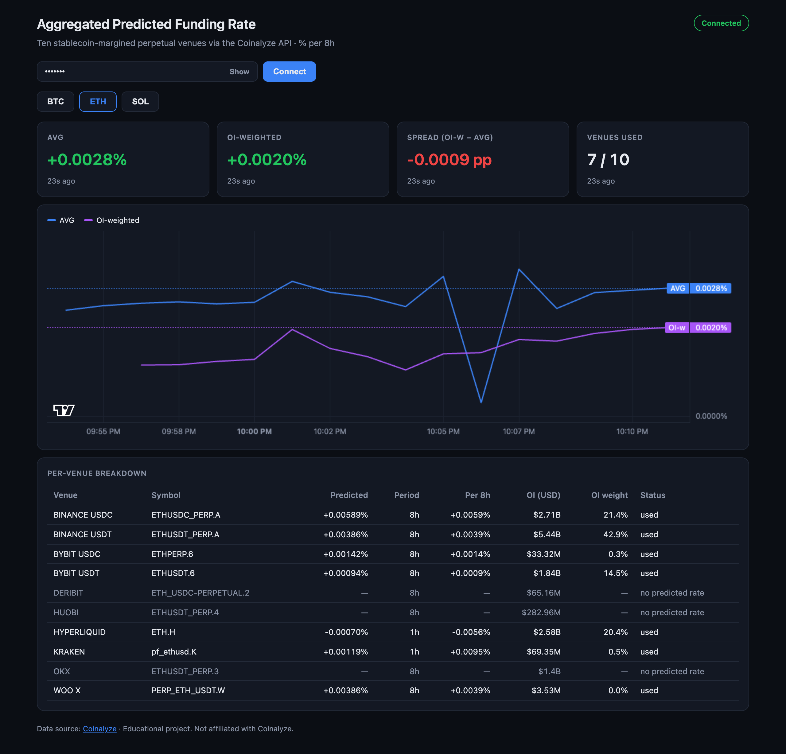
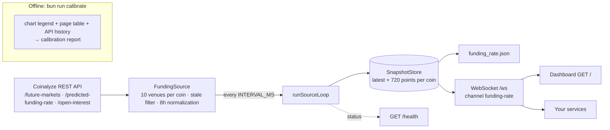

# Predicted Funding Aggregator

[](https://github.com/tarikcaykara/predicted-funding-aggregator/actions/workflows/ci.yml)
[](https://bun.sh)
[](https://www.typescriptlang.org)
[](https://www.docker.com)
[](LICENSE)

A self-hosted Bun + TypeScript service that computes the cross-venue **aggregated predicted funding rate** for BTC, ETH and SOL from the official Coinalyze API, normalized to % per 8h, and streams it over an authenticated WebSocket. Every published number can be traced to its venues: a live dashboard shows the simple and open-interest-weighted averages next to the per-venue breakdown they come from.



## Why

- **The API has no aggregate.** Coinalyze exposes predicted funding rates per market (`/predicted-funding-rate`). Its "Aggregated Predicted Funding Rate" exists only as a chart on coinalyze.net, and the funding page itself notes that the chart *"is not updated in real-time yet"*.
- **The predicted rate is the forward-looking one.** It is the rate the next settlement is heading towards, which makes it a useful input for bots, alerts and carry dashboards.
- **Free, self-hosted and transparent.** Commercial data APIs sell aggregated funding series (for example, CoinGlass offers OI-weighted funding-rate history). This project uses a free API key, runs on your own machine, and documents and measures exactly which venues and normalizations go into each number.

**Which number to use:**
- **AVG:** a simple mean over venues, the same method Coinalyze uses by default.
- **OI-weighted:** weights each venue by its USD open interest, so it reflects where positions actually sit.

## How it works



- **One loop.** Intervals are measured start-to-start and the first poll runs immediately. A failed cycle is logged, counted in `/health` and retried on the next cycle; the loop never exits the process.
- **API budget.** Each symbol in a request costs one call, the limit is 40 calls per sliding 60 s window, and a request takes at most 20 symbols. Predicted rates are fetched first every cycle. Open interest is refreshed on a rolling basis: a market is refetched once its value is 10 min old, oldest first, a few markets per cycle using the spare budget. Defaults (3 coins × 10 venues at 60 s) still come to about 33 calls/min, with no 10-minute burst. A client-side sliding window mirrors the server's, so the client waits instead of being rejected. Two consecutive cycles never fit in one window, so each cycle's first request waits for the previous cycle's first request to leave it, and polls settle at about `INTERVAL_MS` + 250 ms. A 429 (for example from another process using the same key) is retried after `Retry-After` and logged as a warning. `bun run once` is a single poll, so it fetches all open interest at once.
- **Caching.** The market list is cached for 24 h; open interest uses a per-market rolling refresh.
- **Persistence.** The latest snapshot per coin is written to `funding_rate.json`, so a restart serves data immediately. On restart, open interest is also seeded from that file if it is at most 30 min old, so OI-weighted is available from the first poll. History is kept in memory only.

## Methodology

**Venues.** These are the ten stablecoin-margined venues that coinalyze.net lists in the "Current / Predicted" table of each coin's funding page (BTC, ETH and SOL list the same ten). They are defined in [`src/funding/universe.ts`](src/funding/universe.ts). Each venue resolves to the one perpetual on that exchange with that quote currency.

| Venue | Coinalyze code | Quote | API rate period |
|---|---|---|---|
| Binance USDC | A | USDC | 8h |
| Binance USDT | A | USDT | 8h |
| Bybit USDC | 6 | USDC | 8h |
| Bybit USDT | 6 | USDT | 8h |
| Deribit | 2 | USDC | 8h (no predicted rate in the API) |
| Huobi | 4 | USDT | 8h (no predicted rate in the API) |
| Hyperliquid | H | USD | **1h → ×8** |
| Kraken | K | USD | **1h → ×8** |
| OKX | 3 | USDT | 8h (no predicted rate in the API) |
| WOO X | W | USDT | 8h |

Everything else the API lists is deliberately left out, so it cannot skew the average: prediction-market contracts (Polymarket), other quote currencies (ETHBTC, ETHU, USD1), coin-margined contracts and venues the site doesn't aggregate.

**Per venue, every cycle.** Each venue ends up in one of these states:
- `used`: it has a fresh predicted rate.
- `stale`: the rate's `update` timestamp is older than 15 minutes. One API feed was found returning a 12-day-old value.
- `no_rate`: the API reports no predicted rate for it.
- `unlisted`: the coin has no matching perpetual on that venue.

The dashboard and every snapshot show this state for each venue.

**Aggregation over the `used` venues.** For each `used` venue $i$, $r_i$ is its predicted rate normalized to % per 8h and $OI_i$ its open interest in USD:

$$\text{AVG} = \frac{1}{n}\sum_{i=1}^{n} r_i \qquad\qquad \text{OI-weighted} = \frac{\sum_i r_i \cdot OI_i}{\sum_i OI_i}$$

The OI-weighted average only counts venues that also have a positive open interest. It is `null` until open interest has been fetched for every used venue (about 3–4 minutes after a cold start without a recent `funding_rate.json`), and is never computed over a partially fetched set.

## Calibration

The coinalyze.net chart is the reference for both the venue list and the 8h factors. `bun run calibrate` is an offline tool, not part of the service. It drives a headless Chromium (Playwright with `puppeteer-extra-plugin-stealth`) and, once a minute, reads three things:
1. the chart legend "Aggregated Predicted Funding Rate · AVG close 10" on the 1-minute interval;
2. the page's per-venue "Current / Predicted" table;
3. the API's predicted rates for the same venues.

It then reports:
- **Listing drift:** whether the page still shows exactly the venues in `VENUES`.
- **Rate periods:** the median page ÷ API ratio per venue (≈1 for 8h venues, ≈8 for hourly ones).
- **Tracking:** the mean absolute difference (MAD) between the chart and several candidate series. These are compared live, and against the API's own 1-minute predicted-rate history over the previous 3 hours, to measure how far the chart lags and whether it is smoothed.

```bash
bunx playwright install chromium   # once
COINALYZE_API_KEY=… bun run calibrate --samples 60 --gap-s 60   # ≈ 1 hour; Ctrl-C stops early and still reports
```

### Results (2026-10-14 21:11–21:53 UTC, 40 samples)

For BTC, ETH and SOL, the page showed exactly the ten venues in `VENUES`.

| Venue | Expected page ÷ API | BTC | ETH | SOL | Check |
|---|---|---|---|---|---|
| BINANCE USDC | 1 | 0.998 | 0.994 | 1.030 | ok |
| BINANCE USDT | 1 | 0.999 | 1.001 | 0.990 | ok |
| BYBIT USDC | 1 | 1.000 | 0.999 | 0.998 | ok |
| BYBIT USDT | 1 | 0.998 | 0.990 | 1.001 | ok |
| DERIBIT | 1 | — | — | — | no data |
| HUOBI | 1 | — | — | — | no data |
| HYPERLIQUID | 8 | 8.000 | 8.170 | 7.643 | ok |
| KRAKEN | 8 | 7.995 | 8.006 | 8.008 | ok |
| OKX | 1 | — | — | — | no data |
| WOO X | 1 | 0.999 | 1.002 | 0.991 | ok |

| Coin | Mean chart (% per 8h) | API AVG vs chart, lag 0 (MAD) | API history: best lag · MAD | 10-min SMA: best lag · MAD |
|---|---|---|---|---|
| BTC | 0.00576% | 0.00291 pp (50.5%) | 81 min · 0.00175 pp (30.3%) | 78 min · 0.00176 pp (30.5%) |
| ETH | 0.00437% | 0.00101 pp (23.0%) | 165 min · 0.00025 pp (5.6%) | 161 min · 0.00032 pp (7.4%) |
| SOL | -0.00039% | 0.00358 pp (912.0%) | 166 min · 0.00022 pp (55.1%) | 161 min · 0.00050 pp (128.4%) |

Every venue with an API rate lands within 5% of its expected ratio, so the 8h factors hold. Deribit, Huobi and OKX have no predicted rate in the API and show as `no_rate`. For ETH and SOL, the chart matches the API AVG from about 165 minutes earlier (residual MAD 0.00025 pp and 0.00022 pp), and a 10-minute SMA tracks worse. The chart is therefore delayed, not smoothed. BTC tracked poorly in this window (best lag 81 min, MAD 0.00175 pp). SOL's percentages are large because its mean rate is near zero.

## Quick start

1. **Get a free API key.** Sign in or sign up at [coinalyze.net](https://coinalyze.net), open [coinalyze.net/account/api-key](https://coinalyze.net/account/api-key/) and click **Generate**. Generating a key deactivates the previous one immediately, and the new key only starts working **2 minutes** after it was generated.
2. **Configure and run:**

```bash
git clone https://github.com/tarikcaykara/predicted-funding-aggregator.git
cd predicted-funding-aggregator
cp .env.example .env    # set AUTH_TOKEN and COINALYZE_API_KEY
bun install
bun run start           # dashboard on http://localhost:3000, WebSocket on /ws
```

To fetch one snapshot per coin, print it to stdout and exit (exit code 1 if no coin produced a value):

```bash
bun run once
COINS=ETH bun run once
```

Bun loads `.env` automatically, so no `dotenv` package is needed.

## Docker / Compose

```bash
cp .env.example .env    # set AUTH_TOKEN and COINALYZE_API_KEY
docker compose up --build -d
docker compose ps       # "healthy" after the first check
```

- **Image:** about 240 MB. Based on the pinned `oven/bun:1.4.3-debian`, runs as the non-root `bun` user, with a `HEALTHCHECK` on `/health`.
- **Persistence:** compose stores `funding_rate.json` in the named volume `data` (`DATA_FILE=/app/data/funding_rate.json`), so it survives container re-creation.
- **Shutdown:** SIGTERM triggers a graceful shutdown.

## Configuration

| Variable | Default | Description |
|---|---|---|
| `PORT` | `3000` | HTTP + WebSocket port |
| `AUTH_TOKEN` | *(required in loop mode)* | Token WebSocket clients must send; there is no default |
| `COINALYZE_API_KEY` | *(required)* | Coinalyze API key |
| `COINS` | `BTC,ETH,SOL` | Comma-separated subset of `BTC`, `ETH`, `SOL` |
| `INTERVAL_MS` | `60000` | Poll interval. 3 coins at 60 s ≈ 33 of the 40 calls/min |
| `DATA_FILE` | `./funding_rate.json` | Where the latest snapshots are persisted |
| `PING_INTERVAL_MS` | `30000` | WebSocket ping interval |
| `PONG_TIMEOUT_MS` | `65000` | Close a client that hasn't sent a pong within this window |
| `AUTH_TIMEOUT_MS` | `10000` | Close a client that hasn't authenticated within this window |

Integers must be positive whole numbers. Invalid values stop the process at startup with a clear message.

## WebSocket protocol

Endpoint: `ws://<host>:<PORT>/ws`. All messages are JSON. The message types are defined in [`src/protocol.ts`](src/protocol.ts) and shared by the server and the dashboard.

| Direction | Message |
|---|---|
| client → server | `{"type":"auth","token":"<AUTH_TOKEN>"}` (must arrive within `AUTH_TIMEOUT_MS`) |
| server → client | `{"type":"auth","status":"ok","coins":["BTC","ETH","SOL"],"interval_ms":60000}` |
| server → client | `{"type":"history","points":[HistoryPoint, …],"latest":[Snapshot, …]}` right after auth |
| server → client | `Snapshot` on every successful cycle, one per coin |
| server → client | `{"type":"ping"}` every `PING_INTERVAL_MS`; reply with `{"type":"pong"}` |
| server → client | `{"type":"error","message":"invalid json" \| "unknown message type"}` |

A `Snapshot`, which is also the element type of the `funding_rate.json` array (`components` truncated):

```json
{
  "type": "snapshot",
  "symbol": "ETH",
  "coin": "ethereum",
  "timestamp": 1792092779396,
  "aggregated_predicted_funding_rate": 0.006532189523809485,
  "oi_weighted_predicted_funding_rate": 0.008911031122840309,
  "markets": 7,
  "unit": "percent_per_8h",
  "components": [
    {
      "venue": "HYPERLIQUID",
      "symbol": "ETH.H",
      "predicted_rate": 0.00125,
      "rate_period_hours": 1,
      "rate_8h": 0.01,
      "oi_usd": 2605596912.2449627,
      "updated_at": 1792092778452,
      "status": "used"
    }
  ]
}
```

A `HistoryPoint` is a `Snapshot` without `components`.

| Close code | Meaning |
|---|---|
| `4001` | invalid token (the server sends `{"type":"auth","status":"error","message":"invalid token"}` first) |
| `4002` | pong timeout |
| `4003` | no auth message within `AUTH_TIMEOUT_MS` |

**Migrating from v1:**
- `aggregated_predicted_funding_rate`, `coin` and `timestamp` keep their names.
- The value is now this service's API aggregate rather than the number scraped from the chart.
- Several coins share the `funding-rate` channel, so filter on `symbol`.
- The first message after auth is `{"type":"history"}`.
- `funding_rate.json` is an array of the latest snapshot per coin.
- `INTERVAL_MS` keeps its meaning. There is no default `AUTH_TOKEN` anymore.

## `GET /health`

Returns `200` with `"status":"ok"` while the last successful poll is within 3 intervals. Before the first success, it also stays `ok` until 3 intervals have passed since startup. Otherwise it returns `503` with `"status":"down"`.

```json
{ "status": "ok", "uptime_s": 1034, "interval_ms": 60000, "last_success_at": 1792094065961, "consecutive_failures": 0, "last_error": null }
```

## Development

```bash
bun test            # unit + protocol tests; no network, no browser
bun run typecheck   # tsc --noEmit (strict)
```

```
src/
  main.ts                    entry: config → store → source → loop → server; --once; signals
  config.ts                  env/argv → LoopConfig | OnceConfig
  coins.ts                   coin registry (symbol → Coinalyze slug)
  types.ts                   Snapshot, MarketComponent, Source
  protocol.ts                WebSocket messages, close codes, history limit (shared with web/)
  log.ts                     stderr logger (stdout is reserved for --once JSON)
  store.ts                   SnapshotStore (latest + history + funding_rate.json)
  loop.ts                    runSourceLoop (drift-free, never exits)
  health.ts                  computeHealth (pure)
  server.ts                  Bun.serve: dashboard, /health, /ws
  coinalyze/client.ts        CoinalyzeClient (chunking, 429 Retry-After, 401)
  coinalyze/rate-limiter.ts  sliding window (40 calls / 60 s)
  funding/universe.ts        the ten venues and their rate periods
  funding/aggregate.ts       AVG / OI-weighted (pure)
  funding/source.ts          FundingSource (venue resolution, rolling OI, staleness, components)
web/                         dashboard (Bun HTML import + lightweight-charts)
scripts/calibrate/           offline calibration (Playwright; dev dependency)
test/                        bun:test suites
```

## Design notes: v1 → v2

v1 was a single 390-line `scraper.js` that read the number off the chart with headless Chromium. Writing v2 meant fixing what v1 did on bad days and rethinking what the service should be.

**Fixing v1's failure modes:**
- **Zombie process.** A startup failure left the WebSocket server running with scraping dead, and nothing reported it. Now the first poll runs inside the same retrying loop as every other poll, and `/health` reports staleness.
- **Leaked browsers.** Each browser restart leaked a Chromium process. The calibration tool's `BrowserManager` now owns exactly one instance, and a test asserts that each instance is closed exactly once.
- **Silent timeframe reset.** A reload put the chart back on its default interval. A loose selector (`:has-text("1m")`) could also match "1M" (month) or "15m". The interval is now re-selected after every reload from the dropdown item `data-value="1"`, and the selection is verified.

**Rethinking the design:**
- **The chart became an offline tool.** The chart is not real-time, its markup changed while v2 was being written, and keeping it live cost about 1.1 GB of Chromium in the image along with a whole class of shutdown races. Its real value is as a reference, so it now lives in `bun run calibrate`. The service image shrank from 1.32 GB to about 240 MB.
- **Explicit venues instead of "everything the API returns".** An early v2 averaged every stablecoin-margined perpetual the API listed (21 for ETH). That included a prediction market, exotic quote currencies and a 12-day-old value. Pinning the ten venues the site itself aggregates, plus a staleness filter, fixed that and cut the API budget from about 57 to 30 symbols.

## Disclaimer

Educational project, not affiliated with Coinalyze, and not financial advice. The service uses only the official API. The optional offline calibration tool automates a browser session on coinalyze.net; review Coinalyze's terms before running it. Data source: [Coinalyze](https://coinalyze.net).

## License

[MIT](LICENSE)
